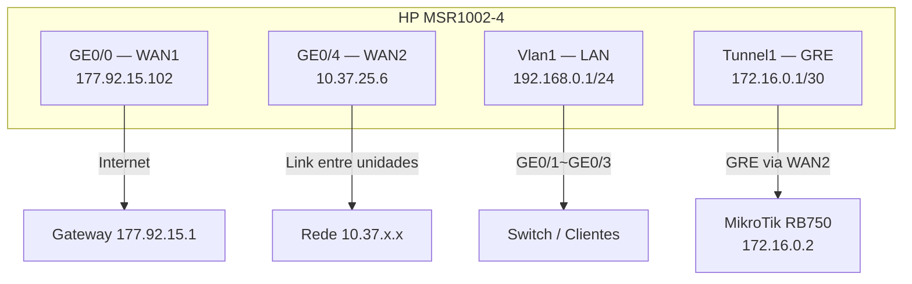

# 🔵 Guia de Configuração — HP MSR1002-4 (Comware 7)

## Informações Gerais

| Item | Valor |
|---|---|
| **Equipamento** | HP MSR1002-4 |
| **Firmware** | Comware 7.1.064, Release 0707P24 |
| **Papel na rede** | Roteador principal — WAN Internet + Link entre unidades |

## Mapa de Interfaces



---

## Configuração Detalhada

### 1. Interface WAN1 — Internet Principal

```
system-view
interface GigabitEthernet 0/0
 description WAN1-INTERNET
 nat outbound 2000
 quit
```

| Parâmetro | Valor |
|---|---|
| Endereço IP | `177.92.15.102` |
| Gateway | `177.92.15.1` |
| NAT | Outbound ACL 2000 |

### 2. Interface WAN2 — Link entre Unidades

```
interface GigabitEthernet 0/4
 description WAN2-LINK-UNIDADE-REMOTA
 quit
```

| Parâmetro | Valor |
|---|---|
| Endereço IP | `10.37.25.6` |
| Propósito | Link físico para alcançar o MikroTik RB750 |

### 3. Túnel GRE — Conectividade com MikroTik RB750

> [!IMPORTANT]
> No Comware 7, a sintaxe obrigatória é `interface TunnelX mode gre`.

```
interface Tunnel1 mode gre
 description TUNEL-GRE-PARA-RB750
 ip address 172.16.0.1 255.255.255.252
 source GigabitEthernet 0/4
 destination 10.37.151.2
 mtu 1476
 quit
```

| Parâmetro | Valor |
|---|---|
| IP local (túnel) | `172.16.0.1/30` |
| IP remoto (túnel) | `172.16.0.2/30` |
| Interface de origem | `GE0/4` (WAN2) |
| Destino GRE | `10.37.151.2` (WAN2 do MikroTik) |
| MTU | `1476` |

### 4. ACL para NAT

> [!NOTE]
> No Comware 7 use `acl basic` em vez de `acl number`.

```
acl basic 2000
 rule 5 permit source 192.168.0.0 0.0.0.255
 rule 10 permit source 192.168.100.0 0.0.0.255
 quit
```

| Regra | Origem | Descrição |
|---|---|---|
| rule 5 | `192.168.0.0/24` | LAN local do MSR |
| rule 10 | `192.168.100.0/24` | LAN remota do MikroTik |

### 5. Rotas Estáticas

```
# Internet via WAN1
ip route-static 0.0.0.0 0.0.0.0 177.92.15.1

# LAN remota do MikroTik via túnel GRE
ip route-static 192.168.100.0 255.255.255.0 172.16.0.2
```

### 6. Salvar

```
quit
save force
```

---

## Verificações Pós-Configuração

| Comando | Resultado Esperado |
|---|---|
| `display interface Tunnel1` | Status **UP/UP** |
| `display ip routing-table` | Rotas para `0.0.0.0/0` e `192.168.100.0/24` |
| `display nat outbound` | NAT na GE0/0 com ACL 2000 |
| `display acl 2000` | 2 regras (LAN local + LAN remota) |
| `ping 172.16.0.2` | Resposta do MikroTik pelo túnel |
| `ping 8.8.8.8` | Teste de saída à internet |

---

> **Arquivo de origem**: [hp_msr1002_config.txt](file:///c:/Users/emanu/CascadeProjects/scripts/hp_msr1002_config.txt)
