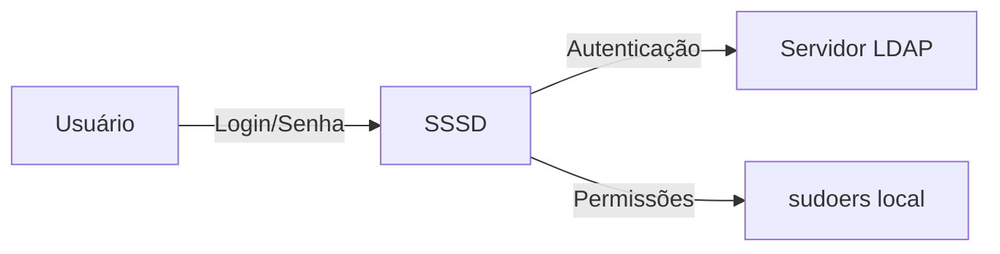

# 🐧 Guia de Configuração — Autenticação LDAP no Ubuntu (SSSD)

## Objetivo

Configurar o Ubuntu para **autenticar usuários via LDAP** usando SSSD, mantendo o controle de **permissões administrativas (sudo) localmente**.



## Arquitetura

| Função | Controlado por |
|---|---|
| Login / Autenticação | **LDAP** |
| Verificação de senha | **LDAP** |
| Criar/gerenciar usuários | **LDAP** |
| Permissão sudo | **LOCAL** (Ubuntu) |
| Membership em grupos sudo | **LOCAL** |

---

## Passo 1 — Instalar Pacotes

```bash
sudo apt update
sudo apt install sssd sssd-tools sssd-ldap libpam-sss libnss-sss oddjob-mkhomedir
```

## Passo 2 — Configurar o SSSD

Edite o arquivo de configuração:

```bash
sudo nano /etc/sssd/sssd.conf
```

Cole o conteúdo abaixo, **ajustando os valores marcados com ⚠️**:

```ini
[sssd]
services = nss, pam
config_file_version = 2
domains = default

[domain/default]
id_provider = ldap
auth_provider = ldap
chpass_provider = ldap

ldap_uri = ldap://SEU_SERVIDOR_LDAP        # ⚠️ Endereço do servidor LDAP
ldap_search_base = dc=exemplo,dc=com       # ⚠️ Base DN do LDAP
ldap_tls_reqcert = allow

cache_credentials = True
enumerate = False

fallback_homedir = /home/%u
```

> [!IMPORTANT]
> Ajuste `ldap_uri` e `ldap_search_base` conforme seu ambiente. Certifique-se que o servidor LDAP permite bind.

### Permissões do arquivo

```bash
sudo chmod 600 /etc/sssd/sssd.conf
```

### Iniciar e habilitar o SSSD

```bash
sudo systemctl enable --now sssd
```

## Passo 3 — Habilitar Login LDAP via PAM

```bash
sudo apt install auth-client-config
sudo pam-auth-update
```

Na tela que aparecer, marque:

- ✅ **SSSD**
- ✅ **Create home directory on login** (mkhomedir)

## Passo 4 — Controlar Permissões Admin Localmente

> [!NOTE]
> O LDAP apenas autentica. Quem tem permissão de `sudo` é definido **localmente** no Ubuntu.

### Opção A — Adicionar direto ao grupo `sudo`

```bash
sudo usermod -aG sudo usuario_ldap
```

### Opção B — Criar grupo local dedicado (recomendado)

```bash
# Criar grupo
sudo groupadd ldap-admins

# Adicionar usuário LDAP ao grupo
sudo usermod -aG ldap-admins usuario_ldap

# Conceder permissão sudo ao grupo
echo "%ldap-admins ALL=(ALL) ALL" | sudo tee /etc/sudoers.d/ldap-admins
```

> [!TIP]
> A **Opção B** é mais limpa e escalável. Facilita a auditoria de quem tem acesso administrativo.

---

## Verificações

| Teste | Comando |
|---|---|
| Login via LDAP | `su - usuario_ldap` |
| Verificar SSSD | `systemctl status sssd` |
| Home criado | `ls /home/usuario_ldap` |
| Sudo funciona | `sudo whoami` (como usuario_ldap) |

---

> **Arquivo de origem**: [Config Ldap ubuntu](file:///c:/Users/emanu/CascadeProjects/scripts/Config%20Ldap%20ubuntu)
