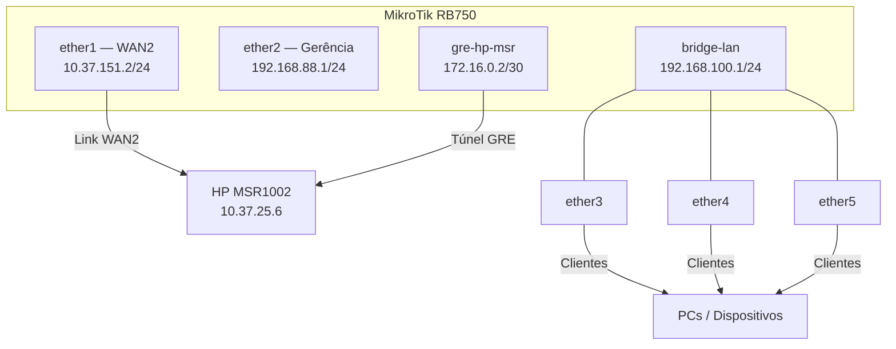

# 🟢 Guia de Configuração — MikroTik RB750 (RouterOS)

## Informações Gerais

| Item | Valor |
|---|---|
| **Equipamento** | MikroTik RB750 |
| **Sistema** | RouterOS |
| **Papel na rede** | Roteador da unidade remota — LAN clientes + túnel GRE |

## Mapa de Interfaces



---

## Configuração Detalhada

### 1. Endereços IP das Interfaces Físicas

```routeros
/ip address add address=192.168.88.1/24 interface=ether2 comment="GERENCIA"
/ip address add address=10.37.151.2/24 interface=ether1 comment="WAN2-HP-MSR"
```

| Interface | IP | Função |
|---|---|---|
| `ether1` | `10.37.151.2/24` | WAN2 — Link para HP MSR |
| `ether2` | `192.168.88.1/24` | Gerência (acesso Winbox/WebFig) |

> [!WARNING]
> `ether2` **NÃO** entra na bridge. É a porta de gerência dedicada.

### 2. Bridge LAN — Portas para Clientes

```routeros
/interface bridge add name=bridge-lan comment="LAN-CLIENTES"
/interface bridge port add bridge=bridge-lan interface=ether3
/interface bridge port add bridge=bridge-lan interface=ether4
/interface bridge port add bridge=bridge-lan interface=ether5
/ip address add address=192.168.100.1/24 interface=bridge-lan comment="LAN-CLIENTES"
```

| Portas na bridge | Rede |
|---|---|
| `ether3`, `ether4`, `ether5` | `192.168.100.0/24` |

### 3. Túnel GRE — Conectividade com HP MSR1002

```routeros
/interface gre add \
  name=gre-hp-msr \
  local-address=10.37.151.2 \
  remote-address=10.37.25.6 \
  mtu=1476 \
  clamp-tcp-mss=yes \
  comment="Tunel-GRE-HP-MSR1002"

/ip address add address=172.16.0.2/30 interface=gre-hp-msr comment="TUNEL-GRE"
```

| Parâmetro | Valor |
|---|---|
| IP local (túnel) | `172.16.0.2/30` |
| IP remoto (túnel) | `172.16.0.1/30` |
| local-address | `10.37.151.2` (ether1) |
| remote-address | `10.37.25.6` (GE0/4 HP MSR) |
| MTU | `1476` |
| TCP MSS Clamp | ✅ habilitado |

### 4. Rotas

```routeros
# Internet via túnel GRE para HP MSR
/ip route add dst-address=0.0.0.0/0 gateway=172.16.0.1 comment="internet-via-tunel-HP"

# Rota WAN2 para HP MSR
/ip route add dst-address=10.37.25.0/24 gateway=10.37.151.1 comment="rota-WAN2-HP"
```

> [!NOTE]
> Todo o tráfego de internet dos clientes sai pelo túnel GRE, passando pelo HP MSR que faz o NAT na WAN1.

### 5. NAT — Masquerade pelo Túnel GRE

```routeros
/ip firewall nat add \
  chain=srcnat \
  out-interface=gre-hp-msr \
  action=masquerade \
  comment="NAT-tunel-GRE"
```

### 6. Mangle — Correção MSS/MTU no Túnel

> [!TIP]
> Esta regra resolve problemas de páginas lentas ou que falham intermitentemente ao acessar pela internet via túnel GRE.

```routeros
/ip firewall mangle add \
  chain=forward \
  protocol=tcp \
  tcp-flags=syn \
  out-interface=gre-hp-msr \
  action=change-mss \
  new-mss=1436 \
  comment="MSS-CLAMP-GRE"
```

### 7. DHCP — Distribuição de IP para Clientes

```routeros
/ip pool add name=pool-lan ranges=192.168.100.100-192.168.100.200

/ip dhcp-server add \
  name=dhcp-lan \
  interface=bridge-lan \
  address-pool=pool-lan \
  disabled=no

/ip dhcp-server network add \
  address=192.168.100.0/24 \
  gateway=192.168.100.1 \
  dns-server=8.8.8.8,8.8.4.4
```

| Parâmetro | Valor |
|---|---|
| Pool | `192.168.100.100` — `192.168.100.200` |
| Gateway | `192.168.100.1` |
| DNS | `8.8.8.8`, `8.8.4.4` |

---

## Verificações Pós-Configuração

| Comando | Resultado Esperado |
|---|---|
| `/ip address print` | Todos os IPs configurados |
| `/interface gre print` | Flag **R** (running) |
| `/ip route print` | Rotas ativas |
| `/ip firewall nat print` | Regra NAT masquerade |
| `/ip firewall mangle print` | Regra MSS clamp |
| `/ip dhcp-server print` | DHCP ativo |
| `/ping 172.16.0.1 count=5` | Resposta do HP MSR pelo túnel |
| `/ping 8.8.8.8 count=5` | Internet funcionando |

---

> **Arquivo de origem**: [mikrotik_rb750_config.txt](file:///c:/Users/emanu/CascadeProjects/scripts/mikrotik_rb750_config.txt)
