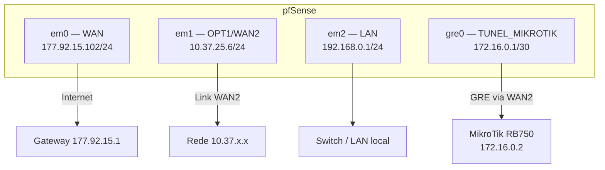

# 🔶 Guia de Configuração — pfSense (Substituto do HP MSR1002)

## Informações Gerais

| Item | Valor |
|---|---|
| **Sistema** | pfSense |
| **Interface** | WebGUI |
| **Papel na rede** | Firewall/Roteador principal — substitui o HP MSR1002 |

### Requisitos Mínimos da VM

| Recurso | Mínimo |
|---|---|
| CPU | 1 vCPU |
| RAM | 1 GB |
| Disco | 8 GB |
| NICs | 2 (WAN + WAN2) ou 3 (WAN + WAN2 + LAN) |

## Mapa de Interfaces

---

## Etapa 1 — Configurar Interfaces Físicas

> **Caminho:** `Interfaces > Interface Assignments`

### WAN (em0) — Internet

| Campo | Valor |
|---|---|
| Caminho | `Interfaces > WAN` |
| IPv4 Config | Static |
| IPv4 Address | `177.92.15.102 / 24` |
| Upstream Gateway | `177.92.15.1` |

### OPT1 (em1) — WAN2

| Campo | Valor |
|---|---|
| Caminho | `Interfaces > OPT1` |
| Enable | ✅ marcado |
| Description | `WAN2` |
| IPv4 Config | Static |
| IPv4 Address | `10.37.25.6 / 24` |

### LAN (em2) — Rede local

| Campo | Valor |
|---|---|
| Caminho | `Interfaces > LAN` |
| IPv4 Config | Static |
| IPv4 Address | `192.168.0.1 / 24` |

---

## Etapa 2 — Criar Túnel GRE

> **Caminho:** `Interfaces > GRE > Add`

| Campo | Valor |
|---|---|
| Parent Interface | WAN2 (em1) |
| GRE Remote Addr | `10.37.151.2` (IP WAN2 do MikroTik) |
| Tunnel Local Addr | `172.16.0.1` |
| Tunnel Remote Addr | `172.16.0.2` |
| Tunnel Subnet | `30` |
| Description | `Tunel-GRE-MikroTik` |

> Salvar e Aplicar

---

## Etapa 3 — Atribuir Interface ao Túnel GRE

> **Caminho:** `Interfaces > Interface Assignments`

1. Em **Network Port**, selecionar a interface `gre0` criada
2. Clicar em **Add** → aparece como **OPT2**

> **Caminho:** `Interfaces > OPT2`

| Campo | Valor |
|---|---|
| Enable | ✅ marcado |
| Description | `TUNEL_MIKROTIK` |
| IPv4 Config | Static |
| IPv4 Address | `172.16.0.1 / 30` |

> Salvar e Aplicar

---

## Etapa 4 — Rotas Estáticas

> **Caminho:** `System > Routing > Static Routes > Add`

| Destination Network | Gateway | Descrição |
|---|---|---|
| `192.168.100.0 / 24` | `172.16.0.2` | LAN-MikroTik-via-GRE |

> Salvar e Aplicar

---

## Etapa 5 — NAT (Outbound)

> **Caminho:** `Firewall > NAT > Outbound`

1. Definir **Mode** como: `Hybrid Outbound NAT`

### Regra 1 — NAT LAN local

| Campo | Valor |
|---|---|
| Interface | WAN |
| Source | `192.168.0.0/24` |
| Translation | Interface Address |
| Description | `NAT-LAN-local` |

### Regra 2 — NAT LAN MikroTik

| Campo | Valor |
|---|---|
| Interface | WAN |
| Source | `192.168.100.0/24` |
| Translation | Interface Address |
| Description | `NAT-LAN-MikroTik` |

> Salvar e Aplicar

---

## Etapa 6 — Firewall (Regras no Túnel)

> **Caminho:** `Firewall > Rules > TUNEL_MIKROTIK > Add`

| Campo | Valor |
|---|---|
| Action | Pass |
| Interface | TUNEL_MIKROTIK |
| Protocol | Any |
| Source | `192.168.100.0/24` |
| Destination | Any |
| Description | `Permitir-LAN-MikroTik` |

> Salvar e Aplicar

---

## Etapa 7 — MSS Clamp (Correção MTU GRE)

### Desabilitar hardware checksum offload

> **Caminho:** `System > Advanced > Networking`
> - ✅ `Disable hardware checksum offload`
> - Salvar

### Regra MSS Clamp

> **Caminho:** `Firewall > Rules > Floating > Add`

| Campo | Valor |
|---|---|
| Action | Match |
| Interface | TUNEL_MIKROTIK |
| Direction | Out |
| Protocol | TCP |
| TCP Flags | SYN |
| Advanced → TCP MSS | `1436` |
| Description | `MSS-CLAMP-GRE-MikroTik` |

> Salvar e Aplicar

---

## Etapa 8 — Captive Portal (Opcional)

> **Caminho:** `Services > Captive Portal > Add Zone`

| Campo | Valor |
|---|---|
| Zone name | `MIKROTIK_ZONE` |
| Interfaces | `TUNEL_MIKROTIK` |
| Enable | ✅ marcado |

### Métodos de Autenticação

| Método | Detalhes |
|---|---|
| **Local Users** | Criar usuário/senha em `Users > Add` |
| **RADIUS** | Servidor IP, Porta 1812, Shared Secret |
| **Vouchers** | Habilitar e gerar vouchers com tempo limitado |

### Configurações Opcionais

| Parâmetro | Valor |
|---|---|
| Idle Timeout | 30 minutos |
| Hard Timeout | 480 minutos (8 horas) |
| Redirect URL | URL após login |
| Logout popup | ✅ marcado |

> Salvar e Aplicar

---

## Etapa 9 — Verificações Pós-Configuração

| Caminho no pfSense | O que verificar |
|---|---|
| `Diagnostics > Ping` (Host: `172.16.0.2`, Interface: TUNEL_MIKROTIK) | Túnel UP |
| `Diagnostics > Ping` (Host: `8.8.8.8`, Interface: WAN) | Internet OK |
| `Diagnostics > Routes` | Rotas `0.0.0.0/0`, `192.168.100.0/24`, `172.16.0.0/30` |
| `Status > Interfaces` | Todas as interfaces UP |
| `Firewall > NAT > Outbound` | Regras NAT para LAN local e MikroTik |
| `Services > Captive Portal > MIKROTIK_ZONE` | Usuários conectados |

---

> **Arquivo de origem**: [pfsense_config.txt](file:///c:/Users/emanu/CascadeProjects/scripts/pfsense_config.txt)
