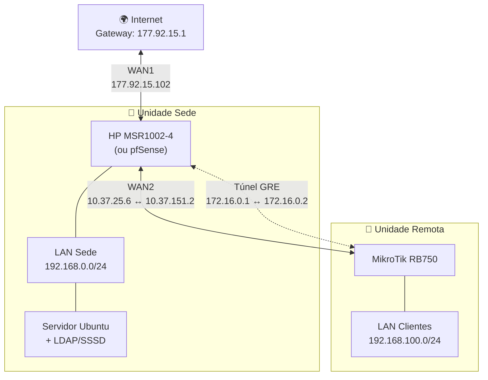

# 🌐 Visão Geral — Topologia de Rede

## Diagrama da Topologia

## Tabela de Endereçamento

| Dispositivo | Interface | IP | Rede | Função |
|---|---|---|---|---|
| **HP MSR / pfSense** | GE0/0 / em0 (WAN) | `177.92.15.102` | WAN1 | Internet |
| **HP MSR / pfSense** | GE0/4 / em1 (WAN2) | `10.37.25.6` | Link unidades | WAN2 |
| **HP MSR / pfSense** | Vlan1 / em2 (LAN) | `192.168.0.1` | `192.168.0.0/24` | LAN Sede |
| **HP MSR / pfSense** | Tunnel1 / gre0 | `172.16.0.1` | `172.16.0.0/30` | Túnel GRE |
| **MikroTik RB750** | ether1 | `10.37.151.2` | Link unidades | WAN2 |
| **MikroTik RB750** | ether2 | `192.168.88.1` | `192.168.88.0/24` | Gerência |
| **MikroTik RB750** | bridge-lan | `192.168.100.1` | `192.168.100.0/24` | LAN Clientes |
| **MikroTik RB750** | gre-hp-msr | `172.16.0.2` | `172.16.0.0/30` | Túnel GRE |

## Guias Individuais

| Dispositivo / Serviço | Guia |
|---|---|
| 🐧 Ubuntu LDAP (SSSD) | [guia_ldap_ubuntu.md](file:///C:/Users/emanu/.gemini/antigravity/brain/4a4ffbc5-1d31-43b9-bd22-da8417fbdc73/guia_ldap_ubuntu.md) |
| 🔵 HP MSR1002-4 (Comware 7) | [guia_hp_msr1002.md](file:///C:/Users/emanu/.gemini/antigravity/brain/4a4ffbc5-1d31-43b9-bd22-da8417fbdc73/guia_hp_msr1002.md) |
| 🟢 MikroTik RB750 (RouterOS) | [guia_mikrotik_rb750.md](file:///C:/Users/emanu/.gemini/antigravity/brain/4a4ffbc5-1d31-43b9-bd22-da8417fbdc73/guia_mikrotik_rb750.md) |
| 🔶 pfSense (WebGUI) | [guia_pfsense.md](file:///C:/Users/emanu/.gemini/antigravity/brain/4a4ffbc5-1d31-43b9-bd22-da8417fbdc73/guia_pfsense.md) |
